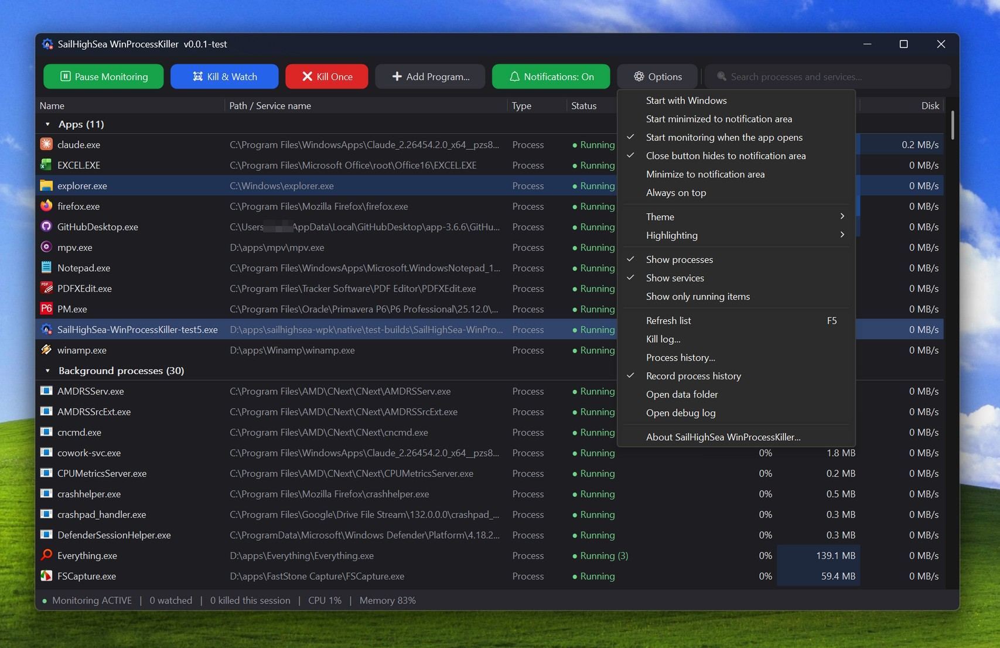

<p align="center">
  
</p>

<h1 align="center">SailHighSea WinProcessKiller</h1>

<p align="center">
  A tiny, open-source Windows tool that keeps the processes and services you choose from running.<br />
  One small <code>.exe</code> (about 170 KB), no installer, no runtime, portable.
</p>

<p align="center">
  <a href="LICENSE"></a>
  
  
</p>

<p align="center">
  
</p>

## What is it?

A sibling of [SailHighSea Firewall](https://github.com/SailHighSea/sailhighsea-fw) with the same look,
but instead of blocking an app's network access it **ends the app**. The window lists every active
process and service. Select one and click **Kill & Watch**: it is terminated now, and a small
background monitor terminates it again every time it starts.

> **Use with care.** Killing the wrong thing can lose unsaved work or break Windows features. Critical
> Windows components (`csrss.exe`, `lsass.exe`, `svchost.exe`, `explorer.exe`, ... and the program
> itself) are protected and cannot be added. **Pause Monitoring** stops all killing at any time.

## Features

- **Live list, grouped like Task Manager:** *Apps* (programs with a window), *Background processes*,
  *Windows processes* (the Windows folder) and *Services*, plus a *Watch list* group on top. Click a group
  title to collapse or expand it. One row per program with an instance count, refreshed automatically.
  Sort by any column, search, and use the toolbar or the right-click menu.
- **CPU, Memory and Disk columns** like Task Manager, with the same blue heat-map shading. Values are
  summed over all instances of a program; the status bar shows total CPU and memory use. Sort by any column.
- **Kill & Watch.** Kill now and keep killing. Double-click a row or press Space to toggle.
- **Kill Once.** End it now without watching it.
- **Add Program...** Put a program on the watch list before it has ever run.
- **Services.** A watched service is stopped (dependent services first). If it will not stop and runs in
  its own process, that process is terminated.
- **Monitor.** A background thread checks twice a second. Per item it shows how many times it killed
  it, and *access denied* when Windows protects the target (for example antivirus services).
- **Process history.** Options > *Process history...* shows every program that started and exited while recording was on, including ones that live only a few milliseconds (they are caught through Windows' own process events, not by polling). Each row has start and end time, how long it ran, name, PID, parent program, command line and path. Filter box, a *Short-lived* switch (under 5 seconds), and *Kill & Watch* to add an entry to the watch list. Recording is off by default (Options > *Record process history*, or the button in the window). Everything is also appended to `process-history.txt` next to the exe. Command lines can contain secrets, so keep that file private. Nothing is recorded while the PC is asleep.
- **Show-window shortcut.** Options > *Shortcut to show the window...* lets you bind your own keys (for example Ctrl+Alt+K). Press them from anywhere in Windows to bring the window up from the notification area; press them again while it is in front to hide it. Nothing is set by default.
- **Notifications.** An optional notification-area pop-up when something was killed.
- **Kill log.** Options > *Kill log...* lists everything killed or stopped this session (time, name, type, result, count, path). Repeats are merged into one row with a count, failures are shown in red, and you can stop watching or copy rows from there.
- **Pause / resume** monitoring from the toolbar or tray; optionally start paused.
- **Dark, light or follow Windows**, sharp on high-DPI, notification-area icon, start with Windows (elevated scheduled task, no UAC prompt), start minimized.
- **Portable.** Settings and the watch list live next to the `.exe`.

## Download

Get the latest `SailHighSea-WinProcessKiller-<version>-win-x64.exe` (or the `.zip`) from the
[Releases](../../releases) page.

| | |
|---|---|
| **To run** | Windows 10 / 11, 64-bit, and administrator rights (a UAC prompt on launch). |

## Using it

1. Start the app (it asks for administrator rights). It lists everything that is running.
2. Select a process or service and click **Kill & Watch** (or right-click it).
3. The row turns red and shows *Auto-kill*. Whenever it starts again it is ended within about half a second.
4. Select it and click **Stop Watching** to let it run again.

Closing the window hides it to the notification area and monitoring continues; **Exit** in the tray
menu (or turning off *Close button hides*) quits and stops monitoring.

Command line: `--minimized` starts hidden, `--paused` (or `--no-monitor`) starts with monitoring paused.

### Files next to the exe

| File | What it is |
|---|---|
| `watch-list.txt` | Your watch list (tab separated: `P`/`S`, name, label, path) |
| `settings.ini` | Options, theme and window position |
| `process-history.txt` | Process history, one line per start / exit (renamed to `process-history.old.txt` at about 8 MB) |
| `debug-log.txt` | Log for bug reports (renamed to `debug-log.old.txt` at about 1 MB) |

## Building from source

Plain C against the Win32 API, cross-compiled with [mingw-w64](https://www.mingw-w64.org/):

```bash
# Linux, WSL or macOS with mingw-w64 installed
cd native
./build.sh                    # produces SailHighSea-WinProcessKiller.exe
./build.sh 0.0.1 0.0.1-dev.1  # numeric version, and the text shown in the title bar
```

On Windows, install [MSYS2](https://www.msys2.org/), then in a *MINGW64* shell:

```bash
pacman -S mingw-w64-x86_64-gcc
cd native
CC=gcc WINDRES=windres ./build.sh
```

Every push to `main` or `dev` runs [`.github/workflows/build-release.yml`](.github/workflows/build-release.yml),
which builds the app, tags the next version and publishes a release (`main` = stable,
`dev` = pre-release).

### Repository layout

| Path | Description |
|---|---|
| `native/main.c` | The whole application |
| `native/build.sh` | mingw-w64 build script |
| `native/app.rc`, `app.manifest`, `app.ico` | Resources: version info, administrator manifest, icon |
| `assets/icon.png` | Icon used in this README |
| `.github/workflows/build-release.yml` | CI build, automatic tagging and releases |

## How it works

- **Processes** are matched by executable file name using a Toolhelp snapshot and ended with
  `TerminateProcess`. The app enables `SeDebugPrivilege` so it can reach other users' processes.
- **Services** are listed with `EnumServicesStatusEx` and stopped with the Service Control Manager.
- Everything that kills runs in one background thread; the UI only edits the watch list.

## Limitations

- Processes are matched by file name, not full path.
- *Disk* is the process's read/write I/O rate (Windows counts files, pipes and network together), so it can
  read higher than Task Manager's disk figure. *Memory* is the private working set. Services that share a
  `svchost.exe` host show no figures, because the host's use cannot be split per service.
- Protected (PPL) processes such as some antivirus services cannot be terminated; they show *access denied*.
- Services set to restart automatically are stopped again on each check, so they may flicker.
- 64-bit Windows only.

## License

MIT. Copyright (c) 2026 SailHighSea WinProcessKiller contributors. See [LICENSE](LICENSE).
